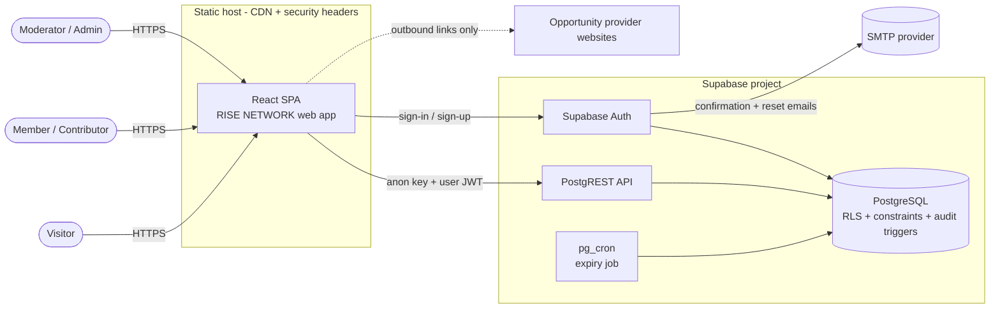

# RISE NETWORK — Architecture

> **Status:** Phase 1 implemented (frontend shell). Backend (Supabase) is **designed, not
> yet implemented**. Last updated: 2026-11-25.

## 1. Overview

RISE NETWORK is a **modular monolith**: one React single-page application talking directly
to one Supabase project (PostgreSQL + Auth). Business rules that protect data — ownership,
roles, publication rules, audit — are enforced **in the database** (constraints, Row Level
Security, `security definer` functions and triggers). The browser is treated as untrusted.

See [ADR-0001](DECISIONS/ADR-0001-technology-stack.md) and
[ADR-0002](DECISIONS/ADR-0002-modular-monolith-database-enforced-rules.md).

## 2. System context



**Trust boundaries**

1. Browser ↔ Supabase: everything from the browser is untrusted. The anon key is public by
   design; authority comes only from the signed-in user's JWT checked by RLS.
2. Supabase ↔ operators: the service-role key and database password are held only by
   operators/CI secrets, never by the SPA.
3. RISE NETWORK ↔ provider websites: we only link out; we never fetch provider URLs
   server-side in MVP (no SSRF surface).

## 3. Component boundaries (frontend)

```
src/
  app/          App shell: router, layout, providers, error boundary
  components/   Shared, presentational UI (design system)
  features/     Business capabilities — each owns its pages, components, data access, rules
    home/  info/  opportunities/  learning/  careers/  (auth/ profile/ admin/ — Phase 2+)
  lib/          Cross-cutting utilities (env, formatting)
  styles/       Design tokens and global styles
```

Rules:

- A feature may import from `components/` and `lib/`, not from another feature's internals.
  Shared domain logic moves into `lib/` only when a second feature needs it.
- Pure domain rules (expiry, status transitions, permission checks for UI hints) live in
  plain TypeScript modules with unit tests. The UI uses them for display; the database
  remains authoritative.

## 4. Data flow (planned, Phase 2–3)

1. Visitor opens `/opportunities?q=bursary&province=GP` → SPA reads URL state → queries the
   `public_opportunities` view via PostgREST (server-side filtering, pagination).
2. Member saves an item → insert into `saved_opportunities` with their JWT → RLS checks
   `user_id = auth.uid()`.
3. Contributor submits → insert into `opportunities` with `status = 'pending_review'` →
   RLS + check constraints ensure they cannot publish.
4. Moderator approves → calls `review_opportunity()` RPC → function verifies role, writes
   `opportunity_reviews`, updates status, writes `audit_logs` — in one transaction.

## 5. Key decisions

| ADR | Decision |
|---|---|
| [0001](DECISIONS/ADR-0001-technology-stack.md) | React + TypeScript + Vite SPA; Supabase (Postgres, Auth); Vitest/RTL/Playwright |
| [0002](DECISIONS/ADR-0002-modular-monolith-database-enforced-rules.md) | Modular monolith; authorisation and integrity enforced in Postgres |
| [0003](DECISIONS/ADR-0003-minimal-dependencies.md) | Minimal dependency policy; no state-management or UI-kit library for MVP |
| [0004](DECISIONS/ADR-0004-interim-visual-direction.md) | Interim visual direction and design tokens |
| [0005](DECISIONS/ADR-0005-git-workflow.md) | Branching and review workflow |

## 6. External dependencies

| Dependency | Purpose | Status |
|---|---|---|
| Supabase (Postgres, Auth, PostgREST) | Data, auth, API | Planned — Phase 2 |
| SMTP provider (via Supabase Auth) | Confirmation and reset emails | Planned — Phase 2 |
| Static host (D-07) | Serving SPA, TLS, headers | Planned — Phase 7 |
| GitHub Actions | CI | Implemented — Phase 1 |
