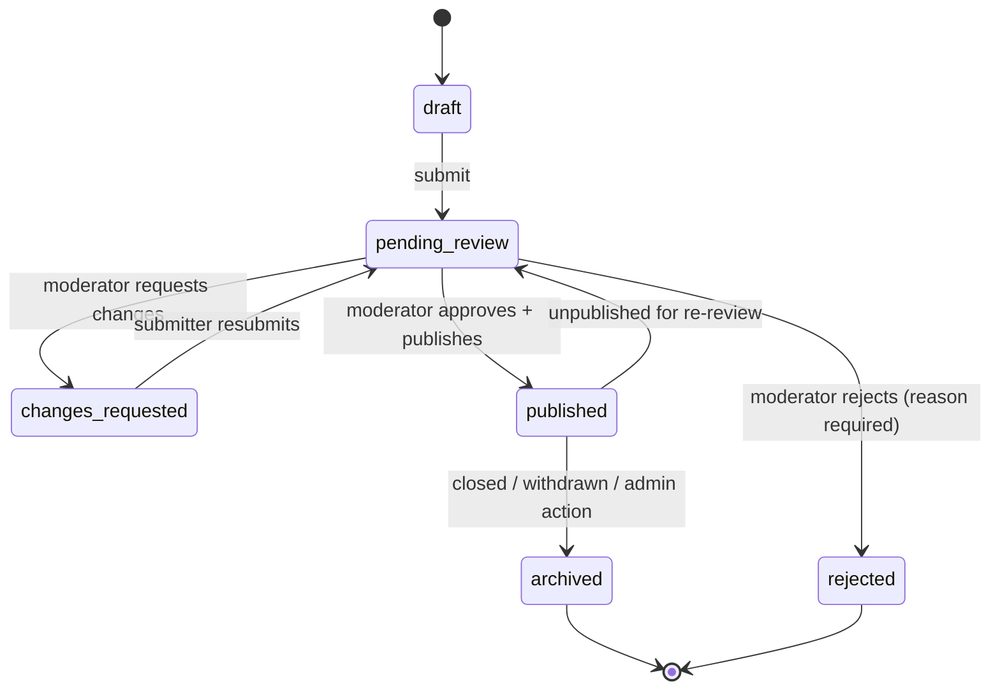

# RISE NETWORK — Content Governance

> **Status:** Policy draft (Phase 0). The workflow is not yet implemented in software
> (Phase 3). Last updated: 2026-11-25.

## 1. Opportunity lifecycle

"Expired" is derived from the closing date and is not a stored status; expired items are
never shown as active and are archived by a daily job.

## 2. Review checklist (before publishing)

1. Source URL is the provider's official page (not a reposting site).
2. Provider is a real, identifiable organisation.
3. Eligibility, required documents, costs and dates match the source exactly — nothing
   invented or inferred.
4. Application link is `https://`, resolves, and leads to the provider's domain or an
   official application portal.
5. No fees are requested from applicants by the listing, or any fee is clearly disclosed
   and confirmed with the provider.
6. No guarantee language.
7. Verification status set honestly, with notes.

## 3. Verification statuses

| Status               | Meaning                                                | Publishable?                                   |
| -------------------- | ------------------------------------------------------ | ---------------------------------------------- |
| `unverified`         | Not yet checked                                        | No (recommended — D-02)                        |
| `source_checked`     | Reviewer confirmed against official source             | Yes                                            |
| `provider_confirmed` | Provider confirmed details directly                    | Yes                                            |
| `needs_recheck`      | Stale (not checked within freshness window) or changed | Yes, with label                                |
| `disputed`           | Reported and under investigation                       | Unpublish or show warning (moderator decision) |

## 4. Freshness

Listings not checked within the freshness window (proposed 30 days, D-06) are flagged
`needs_recheck` on the admin dashboard.

## 5. Reports

Any reported listing enters the moderation queue. Moderators record a decision (dismiss,
correct, mark disputed, unpublish) with a note. Reports involving possible fraud should be
actioned within one working day (target, not a guarantee).

## 6. Sources we do not use

No scraping of third-party sites without permission and a terms review. Preferred sources:
provider submissions, official provider websites checked manually, authorised feeds.
