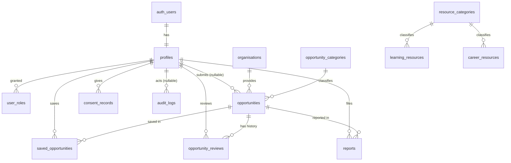

# RISE NETWORK — Data Model

> **Status:** **Proposed (Phase 0).** No migrations exist yet. This model is the input to
> Phase 2 and will be updated to match the migrations once written. Last updated: 2026-11-25.

## 1. Conventions

- PostgreSQL in Supabase; schema `public` for app tables; `auth.users` owned by Supabase.
- `snake_case` names; plural table names; `uuid` primary keys (`gen_random_uuid()`), except
  lookup tables keyed by a stable `text` code.
- All timestamps `timestamptz`, stored in UTC, displayed in `Africa/Johannesburg`.
- Every table has `created_at`; mutable tables also `updated_at` (trigger-maintained).
- Enumerations as Postgres `enum` types where the set is closed and changes are rare;
  lookup tables where admins must maintain the list (categories).
- RLS enabled on **every** table. Default deny.

## 2. Entity-relationship diagram (MVP)

## 3. Entities (MVP)

| Table                    | Purpose                                                      | Key columns / constraints                                                                                                                                                                                                           |
| ------------------------ | ------------------------------------------------------------ | ----------------------------------------------------------------------------------------------------------------------------------------------------------------------------------------------------------------------------------- |
| `profiles`               | Member profile, 1:1 with `auth.users`                        | `id` PK = FK `auth.users.id` ON DELETE CASCADE; `display_name` (1–80 chars); `province` nullable enum; `education_level` nullable enum; `interests text[]` (validated against category codes); timestamps                           |
| `user_roles`             | Role assignments                                             | PK (`user_id`, `role`); `role` enum (`contributor`,`moderator`,`admin`); `granted_by` FK profiles; `granted_at`. Members have no row (implicit role)                                                                                |
| `organisations`          | Opportunity providers (name only in MVP; no "partner" claim) | `name` unique (case-insensitive), `website_url` https check                                                                                                                                                                         |
| `opportunity_categories` | Admin-maintained categories                                  | `code` text PK, `label`, `sort_order`, `is_active`                                                                                                                                                                                  |
| `opportunities`          | Core listing                                                 | see §3.1                                                                                                                                                                                                                            |
| `opportunity_reviews`    | Append-only moderation history                               | `opportunity_id` FK, `reviewer_id` FK, `decision` enum (`approved`,`rejected`,`changes_requested`,`published`,`unpublished`,`archived`), `from_status`, `to_status`, `note`, `created_at`. No UPDATE/DELETE                         |
| `saved_opportunities`    | Member bookmarks + tracking                                  | PK (`user_id`,`opportunity_id`); `tracking_status` enum (`interested`,`applying`,`applied`,`not_proceeding`); ON DELETE CASCADE both sides                                                                                          |
| `learning_resources`     | Learning directory                                           | `title`, `provider`, `category_code` FK, `level` enum, `format` enum, `cost` enum (`free`,`paid`,`funded`,`unknown`), `duration_text`, `requirements`, `url` https, `status` (`draft`,`published`,`archived`), `last_reviewed_at`   |
| `career_resources`       | Career guidance articles/links                               | `title`, `slug` unique, `summary`, `body` (markdown, sanitised on render), `topic` enum, `external_url` nullable, `status`, `last_reviewed_at`                                                                                      |
| `resource_categories`    | Categories for learning/career                               | `code` PK, `label`, `kind`                                                                                                                                                                                                          |
| `reports`                | User reports on listings                                     | `opportunity_id` FK, `reporter_id` FK nullable (ON DELETE SET NULL), `reason` enum (`suspicious`,`incorrect`,`expired`,`other`), `details` ≤ 1000 chars, `status` (`open`,`dismissed`,`actioned`), `resolved_by`, `resolution_note` |
| `consent_records`        | Terms/privacy acceptance history                             | `user_id`, `document` enum (`terms`,`privacy`), `version` text, `accepted_at`                                                                                                                                                       |
| `audit_logs`             | Append-only admin audit trail                                | `id` bigint identity, `actor_id` nullable, `action` text, `entity_type`, `entity_id`, `old_data jsonb`, `new_data jsonb`, `created_at`. Insert only via triggers/functions                                                          |

### 3.1 `opportunities`

| Column                                                 | Type               | Notes                                                                                                                                                                                                                 |
| ------------------------------------------------------ | ------------------ | --------------------------------------------------------------------------------------------------------------------------------------------------------------------------------------------------------------------- |
| `id`                                                   | uuid PK            |                                                                                                                                                                                                                       |
| `slug`                                                 | text unique        | generated from title + short id                                                                                                                                                                                       |
| `title`                                                | text not null      | 5–160 chars                                                                                                                                                                                                           |
| `summary`                                              | text not null      | ≤ 300 chars                                                                                                                                                                                                           |
| `description`                                          | text not null      | markdown, sanitised on render                                                                                                                                                                                         |
| `opportunity_type`                                     | enum               | scholarship, bursary, internship, learnership, graduate_programme, entry_level_job, training, skills_programme, apprenticeship, education_programme, competition, entrepreneurship, grant, volunteering, event, other |
| `category_code`                                        | text FK            | `opportunity_categories`                                                                                                                                                                                              |
| `organisation_id`                                      | uuid FK            | provider                                                                                                                                                                                                              |
| `source_url`                                           | text not null      | `^https://` check (BR-05)                                                                                                                                                                                             |
| `application_url`                                      | text null          | `^https://` check; required to publish unless `application_instructions` set                                                                                                                                          |
| `application_instructions`                             | text null          | for offline applications                                                                                                                                                                                              |
| `location_text`, `province`, `municipality`            |                    | `province` enum incl. `national`, `online`                                                                                                                                                                            |
| `delivery_mode`                                        | enum               | in_person, remote, hybrid                                                                                                                                                                                             |
| `eligibility`, `required_documents`, `required_skills` | text               | provider-supplied only                                                                                                                                                                                                |
| `min_qualification`                                    | enum null          | none, grade_9, matric, certificate, diploma, degree, postgraduate                                                                                                                                                     |
| `age_min`, `age_max`                                   | smallint null      | only if provider states it; check 0–120 and min ≤ max                                                                                                                                                                 |
| `opens_at`                                             | date null          |                                                                                                                                                                                                                       |
| `closes_at`                                            | date null          | null = rolling/no deadline; check `closes_at >= opens_at`                                                                                                                                                             |
| `duration_text`, `financial_details`, `contact_info`   | text null          |                                                                                                                                                                                                                       |
| `status`                                               | enum               | draft, pending_review, changes_requested, rejected, published, archived                                                                                                                                               |
| `verification_status`                                  | enum               | unverified, source_checked, provider_confirmed, needs_recheck, disputed                                                                                                                                               |
| `verification_notes`                                   | text null          |                                                                                                                                                                                                                       |
| `last_checked_at`                                      | timestamptz null   |                                                                                                                                                                                                                       |
| `published_at`                                         | timestamptz null   |                                                                                                                                                                                                                       |
| `submitted_by`                                         | uuid FK null       | ON DELETE SET NULL (D-05)                                                                                                                                                                                             |
| `search_vector`                                        | tsvector generated | title, summary, description, organisation name via trigger                                                                                                                                                            |
| `created_at`, `updated_at`                             | timestamptz        |                                                                                                                                                                                                                       |

**Expiry:** "expired" is **derived** (`closes_at < current_date` in SAST), not a stored
status, so it can never drift. Public listing view filters it out of "active" results;
`archived` is an explicit admin action. A daily job flags expired items for archiving.

**Indexes (query-driven):** `(status, closes_at)` partial where `status='published'`;
GIN on `search_vector`; `(province)`, `(opportunity_type)`, `(category_code)`;
`saved_opportunities(user_id)`; `reports(status, created_at)`;
`audit_logs(entity_type, entity_id)`, `audit_logs(actor_id, created_at)`.

## 4. Data ownership and access (summary — full policies in SECURITY.md once written)

| Table                             | Visitor       | Member               | Contributor    | Moderator    | Admin                |
| --------------------------------- | ------------- | -------------------- | -------------- | ------------ | -------------------- |
| opportunities (published)         | read via view | read                 | read           | read/write   | read/write           |
| opportunities (own non-published) | –             | own (if D-03 allows) | own draft/edit | all          | all                  |
| saved_opportunities               | –             | own                  | own            | own          | own                  |
| profiles                          | –             | own                  | own            | limited read | read                 |
| user_roles                        | –             | own read             | own read       | read         | read/write (via RPC) |
| reports                           | –             | insert               | insert         | read/update  | read/update          |
| audit_logs                        | –             | –                    | –              | –            | read                 |

## 5. Deferred entities (P1+)

`mentors`, `mentorship_requests`, `community_events`, `community_submissions`,
`notifications`, `organisation_members` (partner accounts). Not created until their
requirements and safeguarding rules are approved.

## 6. Seed-data strategy

- `supabase/seed.sql` contains **development fixtures only**, clearly marked
  `[SAMPLE]` in titles and pointing to `https://example.org` URLs, so they can never be
  mistaken for real opportunities.
- Reference data (categories, provinces) is created in migrations, not seed files.
- Production receives no seed data.
