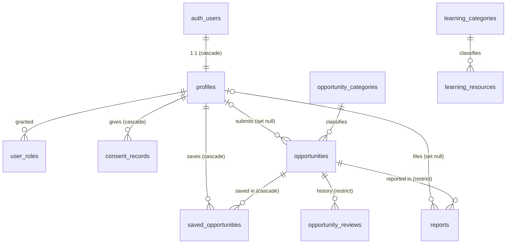

# RISE NETWORK — Data Model

> **Status:** Implemented as migrations in `supabase/migrations/` (Phase 2). This document
> describes those migrations; if they disagree, the migrations are authoritative.
> Last updated: 2026-11-25.

## 1. Conventions

- PostgreSQL 17 in Supabase; app tables in `public`; privileged helper functions in
  `private` (not exposed by the API); `auth.users` owned by Supabase Auth.
- `snake_case`, plural table names, `uuid` primary keys (`gen_random_uuid()`); lookup
  tables keyed by a stable `text` code; `audit_logs` uses a bigint identity.
- All timestamps `timestamptz` (UTC). "Today" for deadlines is computed in
  `Africa/Johannesburg` (`private.today_sast()`).
- `updated_at` maintained by trigger on mutable tables.
- Closed sets are Postgres enums; admin-maintained lists are lookup tables.
- **RLS enabled on every table**, privileges granted explicitly per column where needed,
  function `EXECUTE` revoked from `PUBLIC` (verified by `supabase/tests/database/01_*`).

## 2. Entity-relationship diagram

`audit_logs.actor_id`, `opportunity_reviews.reviewer_id`, `reports.resolved_by` and
`user_roles.granted_by` deliberately have **no foreign key**, so accountability records
survive account deletion as non-identifying references.

## 3. Tables

| Table                    | Purpose                                                                      | Key constraints                                                                                                                                     |
| ------------------------ | ---------------------------------------------------------------------------- | --------------------------------------------------------------------------------------------------------------------------------------------------- |
| `profiles`               | Member profile                                                               | PK = `auth.users.id` (cascade); `display_name` 1–80; optional `province`, `education_level`, `interests` (≤ 20); `age_confirmed_at` NOT NULL (D-01) |
| `user_roles`             | Elevated roles (`moderator`, `admin`). Members have no row                   | PK (`user_id`, `role`)                                                                                                                              |
| `consent_records`        | Terms/privacy acceptance history                                             | `document` enum, `version` 1–32 chars                                                                                                               |
| `audit_logs`             | Append-only audit trail                                                      | Update/delete/truncate blocked by trigger, even for the owner                                                                                       |
| `opportunity_categories` | Field/sector categories (initial set seeded by migration, editable by staff) | `code` pattern `^[a-z][a-z0-9_]{1,40}$`                                                                                                             |
| `opportunities`          | Core listing                                                                 | See §3.1                                                                                                                                            |
| `opportunity_reviews`    | Append-only moderation history                                               | FK restrict; no client write privileges                                                                                                             |
| `saved_opportunities`    | Member bookmarks + tracking status                                           | PK (`user_id`, `opportunity_id`)                                                                                                                    |
| `reports`                | User reports on listings                                                     | Resolution fields consistent with status (check)                                                                                                    |
| `learning_categories`    | Learning categories (seeded, editable)                                       | as above                                                                                                                                            |
| `learning_resources`     | Learning directory                                                           | `url` https; `cost` free/paid/funded/unknown; `status` draft/published/archived                                                                     |
| `career_resources`       | Career guidance                                                              | `slug` kebab-case unique; must have `body` or `external_url`                                                                                        |

### 3.1 `opportunities`

Content: `title` (5–160), `summary` (≤ 300), `description` (≤ 10 000), `opportunity_type`
(16 values), `category_code`, `provider_name`, `provider_url`, `source_url` (**required**),
`application_url`, `application_instructions`, `location_text`, `province`, `municipality`,
`delivery_mode`, `eligibility`, `required_documents`, `required_skills`,
`min_qualification`, `age_min`/`age_max`, `opens_at`, `closes_at`, `duration_text`,
`financial_details`, `contact_info`.

Governance: `status` (draft, pending_review, changes_requested, rejected, published,
archived), `verification_status` (unverified, source_checked, provider_confirmed,
needs_recheck, disputed), `verification_notes`, `last_checked_at`, `published_at`,
`submitted_by` (default `auth.uid()`, set null on account deletion).

Derived: `slug` (title + 8 chars of id, trigger), `search_vector` (generated, weighted
title/provider > summary > description).

Database-enforced rules:

| Rule                                | Constraint                                                                                    |
| ----------------------------------- | --------------------------------------------------------------------------------------------- |
| All URLs `https://` only (BR-04/05) | `private.is_https_url()` checks                                                               |
| Published ⇒ reviewed (D-02, BR-10)  | `status <> 'published' or (verification_status <> 'unverified' and published_at is not null)` |
| Published ⇒ application route       | `application_url` or `application_instructions` present                                       |
| Coherent dates / ages               | `opens_at <= closes_at`; `age_min <= age_max`                                                 |
| Expired never active (BR-03)        | Expiry derived: `public_opportunities.is_closed`; publishing a past-deadline item is refused  |

The provider is stored on each opportunity (`provider_name`, `provider_url`). A separate
organisations table is deferred to partner profiles (P1).

### 3.2 Public read model

`public_opportunities` (view) exposes **only published rows and only public columns**
(no `submitted_by`, `verification_notes`, `status`), plus `is_closed`. It runs with the
owner's rights so anonymous users never need access to the base table. Supabase's linter
will flag it as a "security definer view"; this is intentional and covered by tests.

## 4. Workflow functions (RPC)

| Function                                             | Who              | Effect                                                                                                                                 |
| ---------------------------------------------------- | ---------------- | -------------------------------------------------------------------------------------------------------------------------------------- |
| `submit_opportunity(id)`                             | Owner            | draft / changes_requested → pending_review                                                                                             |
| `review_opportunity(id, action, note, verification)` | Moderator, admin | request_changes, reject, publish, unpublish, archive, set_verification. Writes a review record and audit entry in the same transaction |
| `resolve_report(id, outcome, note)`                  | Moderator, admin | open → dismissed/actioned; audited                                                                                                     |
| `set_user_role(user, role, grant)`                   | Admin            | Grant/revoke role; not own; audited                                                                                                    |
| `delete_my_account()`                                | Signed-in user   | Deletes auth user (cascades); last admin refused                                                                                       |

## 5. Access matrix (enforced by RLS + privileges)

| Table                  | Anon                  | Member                                                                                | Moderator                     | Admin                    |
| ---------------------- | --------------------- | ------------------------------------------------------------------------------------- | ----------------------------- | ------------------------ |
| `public_opportunities` | read                  | read                                                                                  | read                          | read                     |
| `opportunities`        | –                     | read own; insert as draft/pending; edit own draft/changes_requested; delete own draft | read/edit all; status via RPC | same as moderator        |
| `opportunity_reviews`  | –                     | read reviews of own submissions                                                       | read                          | read                     |
| `saved_opportunities`  | –                     | own only                                                                              | own only                      | own only                 |
| `reports`              | –                     | insert; read own                                                                      | read; resolve via RPC         | same                     |
| `profiles`             | –                     | own (limited columns editable)                                                        | own                           | read all                 |
| `user_roles`           | –                     | own                                                                                   | own                           | read all; change via RPC |
| `consent_records`      | –                     | own                                                                                   | own                           | own                      |
| `audit_logs`           | –                     | –                                                                                     | –                             | read                     |
| resources & categories | read published/active | same                                                                                  | full CRUD                     | full CRUD                |

## 6. Rate limits (database)

- Opportunity submissions: 10 per member per 24 h (staff exempt).
- Reports: 20 per member per 24 h.

## 7. Seed-data strategy

- `supabase/seed.sql`: **development fixtures only**, titled `[SAMPLE]`, URLs on
  `example.org`, loaded by `supabase db reset` locally. Never loaded into production.
- Reference data (categories) is created by migrations.
- **First administrator:** there is no self-service path to admin. An operator grants it
  once with SQL (Supabase SQL editor / `psql` as `postgres`):
  `insert into public.user_roles (user_id, role) values ('<user uuid>', 'admin');`
  Further roles are managed through `set_user_role()`.

## 8. Deferred entities (P1+)

`organisations` / partner profiles, `mentors`, `mentorship_requests`, `community_events`,
`community_submissions`, `notifications`. Not created until requirements and safeguarding
rules are approved.
